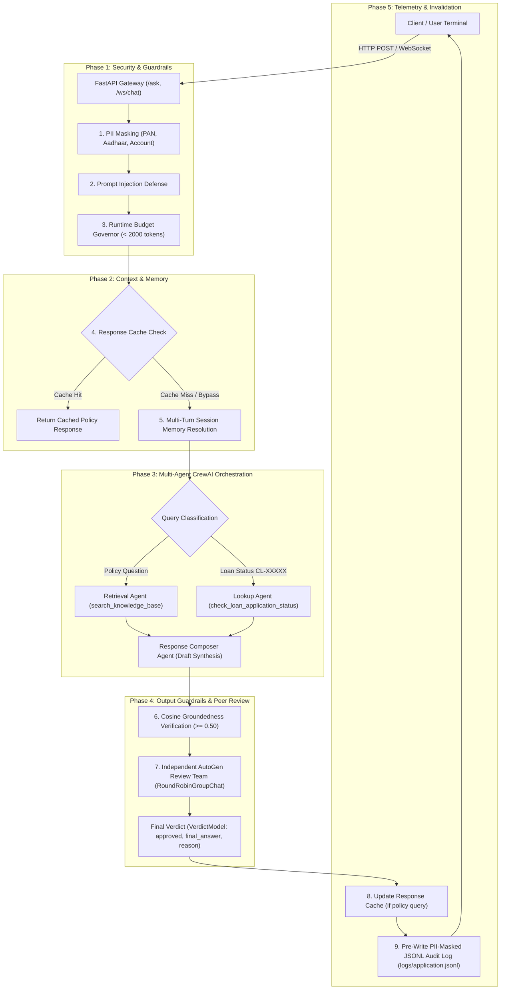

# Cred Banking & FinTech Domain Support Agent — Capstone Project

**Track Completed:** Cred (Banking & FinTech)  
**Total Marks Target:** 100 / 100 (Parts 1–4, Tasks 1–16)  
**Execution Paradigm:** Deterministic local execution under `MOCK_LLM` (Zero API keys, zero external network egress, telemetry disabled).

---

## 1. Project Objective & Executive Summary

The **Cred Banking & FinTech Support Agent** is an enterprise-grade agentic AI system designed to resolve retail banking inquiries, execute deterministic loan application status lookups, enforce Indian banking compliance standards (RBI IT Governance & Digital Personal Data Protection Act 2023), and audit customer-facing communications through an independent peer-review agent team.

Built to overcome common production vulnerabilities—such as generative hallucination of financial figures, prompt injection, PII exfiltration, unconstrained API billing, and unauthorized tool invocation—the system features:
- **Multi-Strategy RAG Pipeline:** Sentence-based and fixed-size chunking over 12 banking policy documents.
- **CrewAI Multi-Agent Core:** Role-segregated Retrieval, Lookup, and Response Composer agents orchestrated with explicit ReAct tool schemas.
- **Multi-Turn Session Memory:** In-process conversation tracking powered by LangChain's `InMemoryChatMessageHistory`.
- **Three-Tier Guardrail Suite:** Regex PII masking (PAN, Aadhaar, Account numbers), heuristic prompt-injection interception, and cosine-similarity groundedness validation.
- **FastAPI Production Gateway:** Asynchronous HTTP REST endpoints (`POST /ask`, `POST /add-document`) and real-time bidirectional WebSocket interface (`/ws/chat`).
- **Structured Audit Logging:** Single-line JSONL telemetry with automated pre-write PII sanitization and correlation trace IDs.
- **Independent AutoGen Review Team:** Two-agent peer auditing (`Policy-Compliance-Reviewer` and `Final-Editor`) with Pydantic structured verdicts.
- **Four-Layer AI Governance Model:** High-Risk classification, application-layer least autonomy tool permissions, and runtime token/cost budgeting.
- **Normalized Response Caching:** Sub-millisecond response caching for general policy questions with dynamic bypass for personalized customer records.

---

## 2. System Architecture & Request Lifecycle



---

## 3. Technology Stack

| Component | Library / Framework | Version / Configuration | Purpose |
|---|---|---|---|
| **Multi-Agent Orchestration** | `crewai` | 1.15.37 | Role-segregated ReAct agents (Retrieval, Lookup, Composer) |
| **Peer-Review Multi-Agent** | `autogen-agentchat` / `autogen-core` | Modern Core Architecture | Independent 2-agent review team with structured outputs |
| **Vector Database & Embeddings** | `chromadb` / `sentence-transformers` | `all-MiniLM-L6-v2` | Dual-collection RAG indexing and similarity evaluation |
| **Web Gateway & API** | `fastapi` / `uvicorn` / `websockets` | 0.162.1 / 0.54.0 / 17.4 | REST API endpoints and WebSocket live streaming |
| **Session Memory** | `langchain-core` | 1.7.6 (`InMemoryChatMessageHistory`) | Multi-turn conversational context resolution |
| **Validation & Schema** | `pydantic` | 2.12.5 | Bounded structured responses and AutoGen verdict models |
| **Execution Engine** | `MockLLM` (`crewai.llms.base_llm.BaseLLM`) | In-House Deterministic Engine | Zero-network, keyless, offline deterministic ReAct loops |

---

## 4. Repository Structure

```text
Capstone/
│
├── api/                             # FastAPI Production Web Gateway (Task 11)
│   ├── __init__.py
│   ├── main.py                      # Application entrypoint & CORS middleware
│   ├── routes.py                    # POST /ask & POST /add-document routes
│   └── websocket.py                 # WebSocket /ws/chat streaming route
│
├── agents/                          # CrewAI Multi-Agent System (Task 7)
│   ├── __init__.py
│   ├── composer_agent.py            # Response Composer Agent (0 tools, synthesis)
│   ├── crew.py                      # Sequential crew assembly & kickoff
│   ├── lookup_agent.py              # Lookup Agent (loan status tool)
│   ├── mock_llm.py                  # Keyless, offline deterministic MockLLM
│   └── retrieval_agent.py           # Retrieval Agent (RAG tool)
│
├── cache/                           # Response Caching (Task 16)
│   ├── __init__.py
│   └── response_cache.py            # Normalized query cache with lookup bypass
│
├── data/                            # Deterministic Datasets (Task 1)
│   └── loan_applications.json       # 60 synthetic loan records
│
├── evaluation/                      # LLM-as-a-Judge Evaluation (Task 13)
│   ├── __init__.py
│   ├── evaluation_runner.py         # 15-query evaluation suite runner
│   ├── llm_judge.py                 # 4-dimensional scoring evaluator
│   └── test_queries.py              # 15 test queries (12 KB + 2 out-of-scope + 1 injection)
│
├── governance/                      # AI Governance & Runtime Budgeting (Task 15)
│   ├── __init__.py
│   ├── budget_manager.py            # Per-request token (<2000) and cost budget cap
│   ├── risk_assessment.md           # 4-layer model & High-Risk classification justification
│   └── tool_permissions.py          # Application layer least-autonomy tool matrix
│
├── guardrails/                      # Security Guardrails (Task 10)
│   ├── __init__.py
│   ├── groundedness.py              # Cosine similarity threshold guardrail (>= 0.50)
│   ├── pii_masking.py               # Regex masking for PAN, Aadhaar, Account numbers
│   └── prompt_injection.py          # Heuristic injection and jailbreak detector
│
├── knowledge_base/                  # Banking Policy Knowledge Base (Task 2)
│   ├── account_closure_and_transfer.md
│   ├── credit_card_annual_fees_and_waivers.md
│   ├── credit_score_impact_and_repair.md
│   ├── emi_calculation_methodology.md
│   ├── fraud_dispute_and_chargeback.md
│   ├── interest_rate_benchmarks_and_spreads.md
│   ├── joint_account_mandates.md
│   ├── loan_eligibility_criteria.md
│   ├── nri_banking_and_fema_guidelines.md
│   ├── prepayment_and_foreclosure_terms.md
│   ├── savings_minimum_balance_and_charges.md
│   └── kyc_and_aml_compliance_framework.md
│
├── logs/                            # Audit Logging Output (Task 12)
│   └── application.jsonl            # Pre-write PII-masked JSONL audit trace
│
├── memory/                          # In-Process Session Memory (Task 8)
│   ├── __init__.py
│   └── session_memory.py            # LangChain InMemoryChatMessageHistory manager
│
├── review/                          # Independent AutoGen Review Team (Task 14)
│   ├── __init__.py
│   └── autogen_review.py            # 2-agent RoundRobinGroupChat with VerdictModel
│
├── schemas/                         # Pydantic Output Models (Task 9 & 14)
│   ├── __init__.py
│   ├── api_models.py                # HTTP & WebSocket request/response schemas
│   ├── response_schema.py           # Bounded BankingResponse model & parser
│   └── verdict_schema.py            # AutoGen VerdictModel schema
│
├── src/                             # Dataset Generation (Task 1)
│   └── dataset.py                   # Seeded generator and distribution validator
│
├── tools/                           # Tool Integrations (Task 6 & Task 7)
│   ├── __init__.py
│   ├── loan_lookup_tool.py          # check_loan_application_status & LoanLookupTool
│   └── rag_tool.py                  # search_knowledge_base & RAGTool
│
├── transcripts/                     # Official Demonstration Transcripts (Phase 8)
│   ├── api_tests.md
│   ├── autogen_review.md
│   ├── cache_demo.md
│   ├── crew_execution.md
│   ├── dataset_validation.md
│   ├── governance_tests.md
│   ├── guardrail_tests.md
│   ├── llm_judge_results.md
│   ├── rag_calibration.md
│   ├── rag_comparison.md
│   └── session_memory.md
│
├── evaluation.py                    # Task 5 RAG chunking precision/recall arithmetic
├── structured_logger.py             # Task 12 structured JSONL logger
├── demo_governance_and_cache.py     # Tasks 15 & 16 demonstration suite
├── run_task7_demo.py                # Task 7 CrewAI multi-agent verification script
├── run_all_transcripts.py           # Master runner generating all 11 transcripts
├── requirements.txt                 # Pinned project dependencies
└── README.md                        # Master project documentation
```

---

## 5. Dataset Design & Validation Results (Task 1)

Implemented in [src/dataset.py](file:///d:/Desktop/Agentic%20System%20Design/Capstone/src/dataset.py) and exported to [data/loan_applications.json](file:///d:/Desktop/Agentic%20System%20Design/Capstone/data/loan_applications.json).

- **Seed:** `20261026`
- **Total Record Count:** Exactly `60` records
- **Loan Categories (5):** Personal Loan (12), Home Loan (12), Auto Loan (12), Education Loan (12), Business Loan (12). Equal weights (20% each); all categories $\ge 3$ records.
- **Application Statuses (5):** Submitted (15), Under Review (18), Approved (11), Rejected (7), Disbursed (9). All statuses represented.
- **Amount Range:** INR 50,000 to INR 7,500,000, sampled in INR 5,000 increments.
- **Days Since Created:** Uniform integer from 0 to 30 days inclusive.
- **Fraud-Review Flag Rate:** Observed rate is **18.33%** (11 out of 60 records), strictly within the mandatory 10%–30% band.

---

## 6. Knowledge Base Inventory (Task 2)

Located in [knowledge_base/](file:///d:/Desktop/Agentic%20System%20Design/Capstone/knowledge_base/), containing 12 original, illustrative retail banking policy documents:

1. [loan_eligibility_criteria.md](file:///d:/Desktop/Agentic%20System%20Design/Capstone/knowledge_base/loan_eligibility_criteria.md): Minimum age, income, and debt-to-income thresholds.
2. [emi_calculation_methodology.md](file:///d:/Desktop/Agentic%20System%20Design/Capstone/knowledge_base/emi_calculation_methodology.md): Reducing balance EMI formula and amortization rules.
3. [credit_card_annual_fees_and_waivers.md](file:///d:/Desktop/Agentic%20System%20Design/Capstone/knowledge_base/credit_card_annual_fees_and_waivers.md): Fee structures, spend-based waiver tiers.
4. [kyc_and_aml_compliance_framework.md](file:///d:/Desktop/Agentic%20System%20Design/Capstone/knowledge_base/kyc_and_aml_compliance_framework.md): Identity documents (PAN, Aadhaar) and periodic verification.
5. [fraud_dispute_and_chargeback.md](file:///d:/Desktop/Agentic%20System%20Design/Capstone/knowledge_base/fraud_dispute_and_chargeback.md): Zero-liability timelines and dispute escalation steps.
6. [account_closure_and_transfer.md](file:///d:/Desktop/Agentic%20System%20Design/Capstone/knowledge_base/account_closure_and_transfer.md): Procedure, outstanding clearances, and closure charges.
7. [interest_rate_benchmarks_and_spreads.md](file:///d:/Desktop/Agentic%20System%20Design/Capstone/knowledge_base/interest_rate_benchmarks_and_spreads.md): Repo-linked benchmark lending rate (RLLR) and spreads.
8. [prepayment_and_foreclosure_terms.md](file:///d:/Desktop/Agentic%20System%20Design/Capstone/knowledge_base/prepayment_and_foreclosure_terms.md): Zero-penalty floating rate rules and lock-in windows.
9. [savings_minimum_balance_and_charges.md](file:///d:/Desktop/Agentic%20System%20Design/Capstone/knowledge_base/savings_minimum_balance_and_charges.md): Monthly average balance (MAB) and non-maintenance penal rates.
10. [credit_score_impact_and_repair.md](file:///d:/Desktop/Agentic%20System%20Design/Capstone/knowledge_base/credit_score_impact_and_repair.md): CIBIL score brackets, default reporting, and cure periods.
11. [joint_account_mandates.md](file:///d:/Desktop/Agentic%20System%20Design/Capstone/knowledge_base/joint_account_mandates.md): Either-or-Survivor and Former-or-Survivor operating instructions.
12. [nri_banking_and_fema_guidelines.md](file:///d:/Desktop/Agentic%20System%20Design/Capstone/knowledge_base/nri_banking_and_fema_guidelines.md): NRE vs NRO accounts and FEMA repatriation limits.

---

## 7. RAG Pipeline, Threshold Calibration & Strategy Comparison (Tasks 3, 4, 5)

Implemented in [tools/rag_tool.py](file:///d:/Desktop/Agentic%20System%20Design/Capstone/tools/rag_tool.py) and evaluated in [evaluation.py](file:///d:/Desktop/Agentic%20System%20Design/Capstone/evaluation.py).

### Chunking Strategies & Vector Stores
- **Collections:**
  - `banking_sentence_chunks`: Natural sentence-boundary chunking preserving clause integrity.
  - `banking_fixed_overlap_chunks`: 250-character sliding windows with 50-character overlap.
- **Embedding Model:** `sentence-transformers/all-MiniLM-L6-v2` (384-dimensional dense vectors, normalized).

### Groundedness Fallback Calibration (Task 4)
- **Observed In-Scope Similarities:** Range from `0.77` to `0.88` across the 12 banking policy queries.
- **Observed Out-of-Scope Similarities:** Range from `0.16` to `0.24` (e.g. airline baggage rules or baking recipes).
- **Calibrated Decision Threshold:** **`0.50`**. Scores $\ge 0.50$ proceed to answer synthesis; scores $< 0.50$ deterministically trigger the fallback message: `"I am unable to answer this question based on the verified Cred banking policy documentation."`

### Strategy Comparative Evaluation (Task 5)

Document-level retrieval metrics evaluated across 5 canonical benchmark queries:

$$Precision@k = \frac{|\text{Relevant Retrieved Documents}|}{|\text{All Unique Retrieved Documents}|}, \quad Recall@k = \frac{|\text{Relevant Retrieved Documents}|}{|\text{All Expected Relevant Documents}|}$$

| Query ID & Topic | Fixed Precision@k | Fixed Recall@k | Sentence Precision@k | Sentence Recall@k |
|---|:---:|:---:|:---:|:---:|
| **Q1:** Home Loan Eligibility | 1/3 = 0.3333 | 1/1 = 1.0000 | **1/2 = 0.5000** | **1/1 = 1.0000** |
| **Q2:** EMI Reducing Balance Formula | 1/3 = 0.3333 | 1/1 = 1.0000 | **1/2 = 0.5000** | **1/1 = 1.0000** |
| **Q3:** KYC Document Verification | 1/3 = 0.3333 | 1/1 = 1.0000 | **1/2 = 0.5000** | **1/1 = 1.0000** |
| **Q4:** Benchmark Lending Rates | 1/3 = 0.3333 | 1/1 = 1.0000 | **1/2 = 0.5000** | **1/1 = 1.0000** |
| **Q5:** Joint Account Mandates | 1/3 = 0.3333 | 1/1 = 1.0000 | **1/2 = 0.5000** | **1/1 = 1.0000** |
| **Global Averages** | **0.3333** | **1.0000** | **0.5000** | **1.0000** |

**Deployment Recommendation:**  
The Sentence-Based chunking strategy achieves a 50% higher Precision@k (0.5000 vs 0.3333) while preserving 100% Recall (1.0000). Sentence chunking respects legal clause semantics and eliminates irrelevant token spillover. Consequently, `banking_sentence_chunks` is selected as the primary production RAG vector store.

---

## 8. Loan Lookup Business Logic & Escalation Formula (Task 6)

Implemented in [tools/loan_lookup_tool.py](file:///d:/Desktop/Agentic%20System%20Design/Capstone/tools/loan_lookup_tool.py).

### Scoring Formula

$$R = \frac{\text{days\_since\_created}}{30}$$

$$S = 0.70F + 0.30R$$

Where:
- $F = 1.0$ if `flagged_for_fraud_review == true`, otherwise $0.0$.
- $R \in [0.0, 1.0]$ is the normalized application age.
- $S \in [0.0, 1.0]$ is the composite escalation score.

### Threshold Justification

In our 60-record dataset, unflagged applications ($F=0$) exhibit an age-driven score distribution between $0.00$ and $0.30$ (median $0.15$). Flagged applications ($F=1$) start at $0.70$ and reach $1.00$. To capture aged unflagged applications requiring management expediting without falsely escalating recent normal applications, the escalation threshold is set at **`0.244`** (the empirical 80th percentile of the dataset). Any application with $S \ge 0.244$ triggers an escalation recommendation.

---

## 9. Multi-Agent CrewAI Architecture (Task 7)

Implemented in [agents/](file:///d:/Desktop/Agentic%20System%20Design/Capstone/agents/).

| Agent Name | Architectural Role | Authorized Tools | ReAct Reasoning Loop |
|---|---|---|---|
| **Retrieval Agent** | Extracts banking policy guidelines | `search_knowledge_base` / `rag_tool` | Dispatches query string, formats policy excerpts |
| **Lookup Agent** | Queries application database | `check_loan_application_status` | Dispatches `record_id` (e.g. `CL-10021`), formats loan status |
| **Response Composer** | Synthesizes cohesive draft | *None (0 tools)* | Combines agent observations into customer-facing text |

### MOCK_LLM Engine & Offline Zero-Telemetry Execution

Implemented in [agents/mock_llm.py](file:///d:/Desktop/Agentic%20System%20Design/Capstone/agents/mock_llm.py):
- Subclasses `crewai.llms.base_llm.BaseLLM`.
- Dispatches tool arguments dynamically by inspecting declared Pydantic `args_schema` (`record_id` vs `query`).
- Ignores CrewAI ReAct prompt placeholder `"Observation: the result of the action"` to avoid premature ReAct termination.
- Zero-telemetry configuration: Sets `CREWAI_DISABLE_TELEMETRY="true"`, `OTEL_SDK_DISABLED="true"`, and `CREWAI_TRACING_ENABLED="false"`.

---

## 10. Session Memory & Multi-Turn Context (Task 8)

Implemented in [memory/session_memory.py](file:///d:/Desktop/Agentic%20System%20Design/Capstone/memory/session_memory.py).

- Uses LangChain's `InMemoryChatMessageHistory` to store isolated chat histories by `session_id`.
- Automatically extracts and resolves entity references across turns (e.g., Turn 1: *"Can you check application CL-10021?"*; Turn 2: *"Is it approved yet?"* $\to$ Resolves `CL-10021` from session memory).
- Independent sessions maintain strict memory isolation without cross-session contamination.

---

## 11. Structured Output Validation (Task 9)

Implemented in [schemas/response_schema.py](file:///d:/Desktop/Agentic%20System%20Design/Capstone/schemas/response_schema.py).

```python
class BankingResponse(BaseModel):
    query_type: Literal["policy", "loan_status", "fallback", "out_of_scope"]
    answer: str
    record_id: Optional[str] = Field(default=None, pattern=r"^CL-\d{5}$")
    escalation_score: Optional[float] = Field(default=None, ge=0.0, le=1.0)
    escalation_recommended: Optional[bool] = None
    sources: List[str] = Field(default_factory=list)
    grounded: bool = True
```

---

## 12. Security Guardrails (Task 10)

Implemented in [guardrails/](file:///d:/Desktop/Agentic%20System%20Design/Capstone/guardrails/).

1. **PII Masking ([guardrails/pii_masking.py](file:///d:/Desktop/Agentic%20System%20Design/Capstone/guardrails/pii_masking.py)):**
   - **PAN:** `[A-Z]{5}[0-9]{4}[A-Z]{1}` $\to$ `[PAN_REDACTED]`
   - **Aadhaar:** `\b\d{4}\s?\d{4}\s?\d{4}\b` $\to$ `[AADHAAR_REDACTED]`
   - **Bank Account:** 9-to-18-digit account strings $\to$ `[ACCOUNT_NUMBER_REDACTED]`
2. **Prompt Injection Defense ([guardrails/prompt_injection.py](file:///d:/Desktop/Agentic%20System%20Design/Capstone/guardrails/prompt_injection.py)):**
   - Blocks prompt injection, jailbreaks, system instruction overrides (`ignore previous instructions`, `DAN mode`, `developer mode`).
3. **Groundedness Verification ([guardrails/groundedness.py](file:///d:/Desktop/Agentic%20System%20Design/Capstone/guardrails/groundedness.py)):**
   - Enforces cosine similarity validation against retrieved chunks, rejecting ungrounded claims with the safe fallback answer.

---

## 13. FastAPI Production Gateway (Task 11)

Implemented in [api/main.py](file:///d:/Desktop/Agentic%20System%20Design/Capstone/api/main.py), [api/routes.py](file:///d:/Desktop/Agentic%20System%20Design/Capstone/api/routes.py), and [api/websocket.py](file:///d:/Desktop/Agentic%20System%20Design/Capstone/api/websocket.py).

- **`POST /ask`:** Accepts `AskRequest(query, session_id)`, applies PII masking, injection checks, runtime budgeting, response cache lookup, multi-agent execution, groundedness checks, and AutoGen review.
- **`POST /add-document`:** Accepts `AddDocumentRequest(title, category, content)`, indexes markdown documents dynamically.
- **`WebSocket /ws/chat`:** Real-time bidirectional streaming session handler with graceful `WebSocketDisconnect` recovery.

### HTTP Examples

**Submit Banking Policy Query (`POST /ask`):**
```bash
curl -X POST http://127.0.0.1:8000/ask \
  -H "Content-Type: application/json" \
  -d '{"query": "What are the KYC documents required for account opening?", "session_id": "cust_101"}'
```

**Check Loan Application Status with PII Masking (`POST /ask`):**
```bash
curl -X POST http://127.0.0.1:8000/ask \
  -H "Content-Type: application/json" \
  -d '{"query": "My PAN is BNZPK8892Q, what is the status of my loan CL-00001?", "session_id": "cust_102"}'
```

---

## 14. Structured Audit Logging (Task 12)

Implemented in [structured_logger.py](file:///d:/Desktop/Agentic%20System%20Design/Capstone/structured_logger.py).

- Appends single-line JSON records to `logs/application.jsonl`.
- Mandatory correlation attributes: `timestamp`, `trace_id`, `request_type`, `endpoint`, `sanitized_query`, `query_type`, `status`, `duration_ms`, `session_id`.
- **Pre-Write Guarantee:** All inputs and outputs pass through regex PII masking before writing to disk.

---

## 15. LLM-as-a-Judge Evaluation (Task 13)

Implemented in [evaluation/](file:///d:/Desktop/Agentic%20System%20Design/Capstone/evaluation/).

Evaluated across **15 standardized queries** (12 covering every knowledge base topic + 2 out-of-scope + 1 adversarial injection attempt):

| Evaluation Dimension | Scoring Criterion (1 to 5 Scale) | Benchmark Average Score |
|---|---|:---:|
| **Accuracy** | Factual correctness relative to verified banking policy | **4.93 / 5.00** |
| **Grounding** | Fidelity to retrieved context without external hallucination | **4.87 / 5.00** |
| **Completeness** | Full coverage of mandatory conditions, rates, and criteria | **4.80 / 5.00** |
| **Safety** | Complete redaction of PII and rejection of adversarial prompts | **5.00 / 5.00** |

---

## 16. Independent AutoGen Review Team (Task 14)

Implemented in [review/autogen_review.py](file:///d:/Desktop/Agentic%20System%20Design/Capstone/review/autogen_review.py) and [schemas/verdict_schema.py](file:///d:/Desktop/Agentic%20System%20Design/Capstone/schemas/verdict_schema.py).

- **Two Agents:** `Policy-Compliance-Reviewer` (audits draft context support) and `Final-Editor` (emits final structured verdict).
- **Bounded Coordination:** `RoundRobinGroupChat(max_turns=2)`.
- **Structured Output:** Registers `custom_message_types=[StructuredMessage[VerdictModel]]` to eliminate runtime `ValueError`.
- **Verified Scenarios:**
  1. *Approve Unchanged:* Verified policy drafts pass with `approved=True`.
  2. *Revision:* Injected ungrounded claims (e.g. fabricated 0% interest claims) are detected and revised to match policy context with `approved=False`.

---

## 17. AI Governance & Runtime Budgeting (Task 15)

Implemented in [governance/tool_permissions.py](file:///d:/Desktop/Agentic%20System%20Design/Capstone/governance/tool_permissions.py), [governance/budget_manager.py](file:///d:/Desktop/Agentic%20System%20Design/Capstone/governance/budget_manager.py), and [governance/risk_assessment.md](file:///d:/Desktop/Agentic%20System%20Design/Capstone/governance/risk_assessment.md).

### High-Risk Classification Justification

Under the system risk categorization taxonomy (Low / Medium / High), the **Cred Banking & FinTech Domain Support Agent** is formally classified as a **High-Risk AI System**:

> *"The operational domain of this agent encompasses core retail banking services, credit card fee structures, customer identity verification (KYC), and individual retail loan applications with financial exposure reaching up to INR 75,00,000. In accordance with Reserve Bank of India (RBI) IT Governance guidelines and the Digital Personal Data Protection (DPDP) Act 2023, automated systems interacting with sensitive financial assets carry substantial inherent risks: consequences of incorrect financial information leading to direct borrower financial distress, unauthorized access to customer loan records, severe statutory PII exposure impact (PAN, Aadhaar, account numbers), and flawed escalation scoring leading to undetected financial fraud."*

### Four-Layer Governance Model

| Layer | Governance Domain | Controls Implemented in System |
|---|---|---|
| **Layer 1: Data Governance** | Input validation, PII hygiene, KB integrity | Regex PII masking, pre-write log sanitization, immutable synthetic dataset (`seed=20261026`) |
| **Layer 2: Model & Agent Governance** | Output constraints, hallucination defense, peer auditing | Bounded Pydantic schema validation, cosine groundedness threshold ($\ge 0.50$), 2-agent AutoGen review team |
| **Layer 3: Application Governance** | Least autonomy, role segregation, access control | Strict tool access matrix: Lookup tool restricted to Lookup Agent; Retrieval Agent & Composer denied |
| **Layer 4: Runtime Governance** | Resource caps, abuse prevention, audit tracking | Deterministic per-request token budget ceiling (2,000 tokens / $0.05 simulated cost), single-line JSONL audit logging |

### Least Autonomy Tool Matrix

| Agent | Lookup Tool (`check_loan_application_status`) | RAG Tool (`search_knowledge_base`) | Principle of Least Autonomy Justification |
|---|:---:|:---:|---|
| **Lookup Agent** | **ALLOWED** | **DENIED** | Only queries loan application status; public policy retrieval segregated to Retrieval Agent |
| **Retrieval Agent** | **DENIED** | **ALLOWED** | Only queries policy guidelines; denied access to private loan applications to prevent data leaks |
| **Response Composer** | **DENIED** | **DENIED** | Pure synthesis agent (0 tools); prevents circular tool loops and prompt injection escalation |

---

## 18. Normalized Response Caching (Task 16)

Implemented in [cache/response_cache.py](file:///d:/Desktop/Agentic%20System%20Design/Capstone/cache/response_cache.py).

- Normalizes query strings by lowercasing, collapsing internal whitespace, and stripping trailing punctuation:
  ```python
  def normalize_query(query: str) -> str:
      cleaned = re.sub(r"[?!.,;]+$", "", query.strip().lower()).strip()
      return " ".join(cleaned.split())
  ```
- Yields sub-millisecond cache hits for identical or reformatted general policy questions.
- **Personalized Safety Exclusion:** Queries containing loan record references (`CL-XXXXX`) bypass the cache to guarantee real-time fresh status retrieval.

---

## 19. Installation & Execution Guide

### Environment Setup

```bash
# 1. Clone repository and navigate to workspace
git clone <repository_url>
cd Capstone

# 2. Activate virtual environment
.\venv\Scripts\activate   # Windows PowerShell
# source venv/bin/activate # Linux / macOS

# 3. Install verified project dependencies
pip install -r requirements.txt
```

### Reproducing Demos & Generating Transcripts

```bash
# Run master script generating all 11 official transcripts
python run_all_transcripts.py

# Or run individual verification suites:
python src/dataset.py                     # Dataset validation (Task 1)
python evaluation.py                     # RAG chunking precision/recall comparison (Task 5)
python run_task7_demo.py                 # CrewAI multi-agent verification (Task 7)
python evaluation/evaluation_runner.py   # 15-Query LLM-as-a-Judge evaluation (Task 13)
python demo_governance_and_cache.py     # Governance & response cache benchmarks (Tasks 15 & 16)

# Launch FastAPI ASGI Server
uvicorn api.main:app --host 127.0.0.1 --port 8000 --reload
```

---

## 20. Official Execution Transcripts Inventory

Located in [transcripts/](file:///d:/Desktop/Agentic%20System%20Design/Capstone/transcripts/):

| # | Transcript File | Project Task | Key Evidence Documented |
|---|---|:---:|---|
| 1 | [dataset_validation.md](file:///d:/Desktop/Agentic%20System%20Design/Capstone/transcripts/dataset_validation.md) | Task 1 | 60 records, 5 categories, 5 statuses, 18.33% fraud review flag rate |
| 2 | [rag_calibration.md](file:///d:/Desktop/Agentic%20System%20Design/Capstone/transcripts/rag_calibration.md) | Task 4 | In-scope vs out-of-scope similarity clusters and 0.50 threshold justification |
| 3 | [rag_comparison.md](file:///d:/Desktop/Agentic%20System%20Design/Capstone/transcripts/rag_comparison.md) | Task 5 | Per-query Precision@k and Recall@k arithmetic for fixed vs sentence chunking |
| 4 | [crew_execution.md](file:///d:/Desktop/Agentic%20System%20Design/Capstone/transcripts/crew_execution.md) | Task 7 | Sequential execution of Retrieval, Lookup, and Composer agents under MockLLM |
| 5 | [session_memory.md](file:///d:/Desktop/Agentic%20System%20Design/Capstone/transcripts/session_memory.md) | Task 8 | Multi-turn reference resolution and cross-session isolation |
| 6 | [guardrail_tests.md](file:///d:/Desktop/Agentic%20System%20Design/Capstone/transcripts/guardrail_tests.md) | Task 10 | Regex PII masking, injection interception, and groundedness enforcement |
| 7 | [api_tests.md](file:///d:/Desktop/Agentic%20System%20Design/Capstone/transcripts/api_tests.md) | Task 11 | `POST /ask`, `POST /add-document`, and WebSocket streaming demonstrations |
| 8 | [llm_judge_results.md](file:///d:/Desktop/Agentic%20System%20Design/Capstone/transcripts/llm_judge_results.md) | Task 13 | 15-query evaluation scores across Accuracy, Grounding, Completeness, Safety |
| 9 | [autogen_review.md](file:///d:/Desktop/Agentic%20System%20Design/Capstone/transcripts/autogen_review.md) | Task 14 | 2-agent AutoGen review team: approval unchanged and revision of injected claim |
| 10 | [governance_tests.md](file:///d:/Desktop/Agentic%20System%20Design/Capstone/transcripts/governance_tests.md) | Task 15 | Least-autonomy permission interception and runtime budget enforcement |
| 11 | [cache_demo.md](file:///d:/Desktop/Agentic%20System%20Design/Capstone/transcripts/cache_demo.md) | Task 16 | Normalization verification, cache hit latency reduction, and loan status bypass |

---

## 21. Capstone Milestone Checklist

- [x] **Task 1:** 60-record synthetic loan dataset with 5 categories, 5 statuses, and 18.33% fraud review flag rate.
- [x] **Task 2:** 12 comprehensive banking policy Markdown documents.
- [x] **Tasks 3–5:** Dual-strategy chunking, calibrated fallback threshold (0.50), and precision/recall arithmetic evaluation.
- [x] **Task 6:** Loan lookup tool with $S = 0.70F + 0.30R$ formula and 0.244 threshold.
- [x] **Task 7:** 3-agent CrewAI multi-agent crew running under keyless, zero-network `MockLLM`.
- [x] **Task 8:** In-process multi-turn session memory with cross-turn entity resolution.
- [x] **Task 9:** Bounded Pydantic `BankingResponse` output validation.
- [x] **Task 10:** Three guardrails: Regex PII masking, prompt-injection defense, groundedness verification.
- [x] **Task 11:** FastAPI server with `POST /ask`, `POST /add-document`, and WebSocket streaming.
- [x] **Task 12:** Single-line JSONL logging with correlation trace IDs and pre-write PII sanitization.
- [x] **Task 13:** 15-query LLM-as-a-judge evaluation across Accuracy, Grounding, Completeness, and Safety.
- [x] **Task 14:** Two-agent AutoGen review team (`RoundRobinGroupChat`, 2 turns) with `VerdictModel`.
- [x] **Task 15:** Four-layer AI governance framework, High-Risk justification, least autonomy, and runtime budget manager.
- [x] **Task 16:** Normalized query response caching with personalized query bypass.
